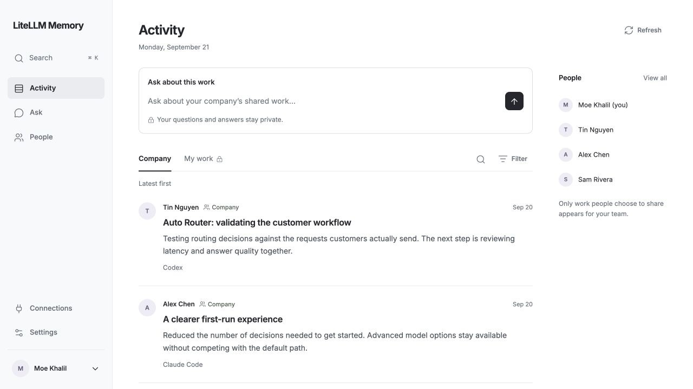

# LiteLLM Memory

See what your team is working on. Ask about anything shared with you.

A [LiteLLM Labs](https://github.com/BerriAI) product, built with [Ente](https://github.com/ente-io/ente) and [LiteLLM](https://github.com/BerriAI/litellm).

LiteLLM Memory records the work people do with AI and makes it easy to ask about later. Connect Codex or Claude Code, browse your company’s shared work and your own private history, and ask questions in the web app or through **@memory** in Slack.

This is a work archive you query deliberately. It does not search old memories or inject context into every coding turn.

> **Release status:** the implementation is on `main`. Deployment verification is in progress. The existing hosted assistant has not been switched to this application. See the [release checklist](docs/release-checklist.md) for verified behavior and remaining gates.



The actual application, shown with synthetic local records. See [Ask](docs/assets/ask.jpg), [privacy settings](docs/assets/settings.jpg), and the [interface guide](docs/ui-review.md) for more screenshots and verification details.

## What it does

- **Browse:** Company opens first, with a chronological feed and Slack profiles. Open a teammate’s shared activity or switch to My work.
- **Record:** connect Codex or Claude Code once. An encrypted local outbox retries uploads; optional backfills preserve original text, dates and metadata. Connection status shows when work actually arrives.
- **Share deliberately:** work starts private. Preview a separate summary, or opt in to sharing future summaries. TypeSafe Jev checks your private topics in parallel and caches completed checks.
- **Ask:** get cited answers through the web, Slack, API or MCP, limited to the evidence the audience can access. No automatic recall on coding turns or scheduled daily digests.
- **Use your gateway:** model choices come from LiteLLM. Optional [Pydantic Logfire](docs/observability.md) shows usage and latency without private content.

See the [member guide](docs/member-guide.md) for filtering, privacy, exports and account controls.

## Deploy

[](https://render.com/deploy?repo=https://github.com/moe-berri/litellm-memory/tree/main)

The Blueprint provisions the web app, a persistent volume and PostgreSQL. Ente Museum runs privately alongside the app and is provisioned automatically. Review Render's charges before creating the deployment; durable hosting is not a free-tier promise. This repository currently requires GitHub access. Once published, others can fork and deploy it with their own infrastructure and gateway.

**On any Docker host:**

```sh
git clone https://github.com/moe-berri/litellm-memory.git
cd litellm-memory
./scripts/self-host.sh
```

Open the address shown by your deployment. Setup stays on one page:

1. Claim the installation using its deployment setup code.
2. Connect your **LiteLLM URL and API key**. LiteLLM Memory discovers models, suggests defaults, and checks Jev through the gateway.
3. Connect Slack and finish with your verified company identity. Slack returns you to the same setup page.

Members then use **Sign in with Slack**. They do not handle encryption keys, recovery phrases or a separate LiteLLM Memory password. Eligibility is restricted to the configured Slack workspace and exact verified email domain; `berri.ai` is the initial default and self-hosters choose their own domain.

**Jev is required.** Built-in support starts in LiteLLM **v1.103.0-rc**. Use a gateway release with the [TypeSafe integration](https://docs.litellm.ai/docs/pass_through/typesafe), and configure `TYPESAFE_API_KEY` on that gateway. Setup explains missing capabilities and retains your inputs. LiteLLM Memory never asks members for a TypeSafe key or bypasses the gateway. See [gateway setup](docs/self-hosting.md#connect-typesafe-jev-through-litellm).

Read [self-hosting](docs/self-hosting.md) for HTTPS, backups, updates, external Ente and configuration.

## Connect your tools

Open **Connections → Set up continuous capture** in LiteLLM Memory. On the computer running your coding tools:

```sh
uv tool install --force 'git+https://github.com/moe-berri/litellm-memory.git@main'
litellm-memory-connector connect https://your-litellm-memory.example
```

Sign in with Slack in the browser. The connector preserves existing host settings and memory connections. Restart your coding tool, then authenticate its LiteLLM Memory MCP when prompted. Use `--host codex` or `--host claude` to configure only one.

The connector records visible user and assistant text. It excludes system messages, tool-result dumps and hidden reasoning. Local capture requires a compatible host with transcript hooks; remote MCP alone cannot observe conversations. The website and Slack work without installing the connector.

[Member guide](docs/member-guide.md) · [Connector guide](docs/connectors.md) · [API and data formats](docs/api.md)

## How privacy works

LiteLLM Memory encrypts persisted records with Ente-compatible libsodium encryption and stores ciphertext in Ente Museum. Each member has a separate wrapped key. Original evidence, derived records, public summaries, profiles, jobs and configuration are encrypted at rest; search indexes live in bounded process memory.

**The hosted application is a trusted processor.** It can decrypt authorized work to search it and call the LiteLLM gateway. A person controlling the runtime and its keys could also do that. This is not Ente Photos' zero-knowledge client model, and we do not claim protection against a malicious deployment operator.

Normal administrator interfaces cannot inspect someone else's private records. API authorization is checked before decryption and again before delivering agent output. Publishing shares a separate summary, while the original evidence stays private. Requests ask LiteLLM to suppress content logging, and agent tracing is disabled; the gateway and model provider still need appropriate retention settings.

Read the [security and privacy model](docs/security.md) before operating an installation.

## Develop

```sh
uv sync --frozen
uv run pytest -q
uv run ruff check .
```

The app is `litellm_memory.application:app`; the portable launcher is `python -m litellm_memory.boot`.

[Architecture](docs/architecture.md) · [Product specification](docs/product-implementation-spec.md) · [Release checklist](docs/release-checklist.md) · [Answer-quality evaluation](docs/answer-quality.md)

See [CONTRIBUTING.md](CONTRIBUTING.md) for local development, code orientation and review expectations.

## Open source

LiteLLM Memory is licensed under **AGPL-3.0**. The bundled Ente Museum executable is unmodified and also AGPL-3.0; see [LICENSE](LICENSE) and [third-party notices](THIRD_PARTY_NOTICES.md). The self-hosted core needs no proprietary LiteLLM Memory control plane. Hosting and model inference may have costs.

Code belongs here; personal histories, credentials, deployment state and database exports do not. Keep those out of Git, even in a private fork.
