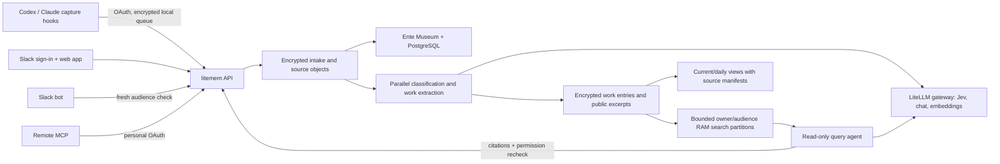

# Architecture

litemem stores evidence about people's work. Its retrieval is explicit: a capture hook records new work; a user later opens Ask, searches the archive, or asks @litemem. Capturing a normal coding turn never performs background recall into that conversation.

## Capture and evidence

The connector reads complete appended transcript rows. Local encrypted queue insertion and cursor advancement share a transaction. The API binds the owner from authentication, derives a stable record ID from the owner/source identity, rejects content replacement under the same ID, and commits encrypted intake before remote I/O. Unavailable Ente writes remain in `storing` for recovery. The original source object is immutable; the derived working object is replaceable.

Historical ingestion uses the same path with separate worker capacity and historical dates. Byte-preserved legacy originals live inside encrypted source metadata. Source role/uploader are provenance, not proof of who made a claim.

## Processing

Each worker claims a lease tied to current policy. Jev classifies overlapping source chunks through the configured LiteLLM TypeSafe pass-through. Cache identity includes the content/chunk, criterion and classification version. Successful chunks survive a sibling failure; adding a criterion asks only the missing questions. Model changes deliberately create new classification/index generations.

The background model describes the work briefly with projects and attribution. New accounts have no required category taxonomy; Jev checks user-written privacy topics. Older restrictive type policies keep their cached classifiers. Original content remains searchable even before processing finishes. Embeddings include their model identity and dimensions; incompatible query vectors fall back to keyword search.

Daily/current views are rebuilt from selected source entries, not recursively from prior summaries. They include validated source IDs, timestamps and coverage. Private/public views have separate input sets. No-change generations are reused; policy changes invalidate old derived output before it is returned. Historical daily views can be requested for a particular date.

## Retrieval

Encrypted source and embedding payloads persist in SQLite/Ente. FTS5 and vector working indexes are partitioned by owner, audience and bounded ID groups in process memory. An estimated 128 MB LRU budget limits resident plaintext, configurable with `SEARCH_CACHE_MB`. Fingerprints reuse unchanged partitions. Queries never build a plaintext disk index or load all private team content at once.

Fingerprint enumeration uses disjoint owner and company-public metadata scans. A partial public index proves that a separate publication exists without loading its encrypted row. The owner branch uses a covering metadata index. Both branches enforce workspace, membership and audience boundaries before any partition is decrypted; a missing public summary cannot fall back to the original. Publication changes automatically update the partial index. This keeps warm searches from reading large encrypted records merely to check their presence.

Keyword ranking uses per-partition SQLite FTS5 BM25; vector ranking uses cosine similarity over compatible model/dimension vectors. Global top keyword and semantic candidates are fused with reciprocal rank fusion (`k=60`). Search returns up to 200 keyword and 100 semantic candidates before pagination; `total` is the ranked candidate count for a query, not an exact count of every possible semantic match. Feed browsing is chronological and bounded to 10,000 results per date-filtered request.

The agent receives only authorized search/read/people/overview tools. Web, Slack and MCP use the same query service, with server-owned follow-up history and frozen model choices for each in-flight request. The UI's model picker follows the gateway's key-scoped `/v1/models`, not a baked-in provider list.

## Key custody and processes

Ente Museum is the opaque encrypted object store. litemem holds the authorized hosted processor's root key and separate member key envelopes; this is not zero knowledge against the operator. The portable boot process automatically provisions Museum, disables further registration, initializes the memory namespace, then runs the application. It supervises both processes and does not expose Museum's port publicly.

SQLite persists membership/policies, encrypted records/jobs, classification cache, OAuth token hashes, requests and current views. It makes the starter deployment simple and single-replica. PostgreSQL belongs to Museum. Neither GitHub nor a proprietary SaaS control plane stores the team's live work archive.

`migration.py` keeps temporary recipient-encrypted packets and encrypted receiving keys in `transfers.sqlite3`. A single-tab, owner-approved browser flow carries a scoped upload capability between installations. The destination verifies the complete manifest before a durable worker restores private original sources through normal capture. It checkpoints each record, preserves deletion tombstones, and stops on departure, cancellation or expiry. Imported derived views are rebuilt with local models. See the [transfer protocol and retention](security.md).
