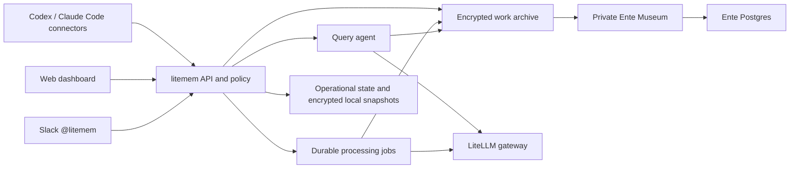

# litemem — product and implementation specification

Version 1.0 · September 20, 2026 · Authoritative build specification

**Deploy a private home for your team's work history. Connect AI tools, let your agent organize what happens, and ask about your own work or the work colleagues choose to share.**

This document incorporates the full product discussion and replaces earlier product specifications and implementation plans. It describes the finished product, engineering contracts, delivery order and evidence required for completion. Existing code is an implementation starting point, not a constraint on the design. The current implementation status appears at the end; requirements below are not claims that everything already works.

## 1. Product decisions

| Decision | Required behavior |
| --- | --- |
| Product and ownership | **litemem**, a LiteLLM Labs product. Slack agent: **@litemem**. Code lives in `moe-berri/litemem` until its owner moves it. |
| One application | The memory system, agent, dashboard, Slack integration, remote MCP, imports and administration belong to the same product and repository. |
| Purpose | Queryable evidence of what people are doing with AI; useful history and current work, rather than automatic coding-agent recall. |
| Deployment | One-click infrastructure deployment on Render, followed by guided web setup. The same application is deployable on other Docker-capable hosts. |
| Identity | Slack-only member sign-in. For Berri: the configured workspace and a verified `berri.ai` email. No separate member password or memory key to remember. |
| Models | The only inference connection is a LiteLLM URL and key. Discover models there; show whether TypeSafe/Jev is accessible. Jev is required for this version. Admin chooses embedding and default web models; Slack initially inherits the web default and can have its own model. |
| Background work | Configurable background model for extraction, maintenance and daily summaries; inherits the default agent unless overridden. Jev/TypeSafe for typed classification. All model traffic goes through LiteLLM. |
| Memory | Preserve original evidence; derive concise work entries and rebuildable current views. Maintain metadata, attribution, time and corrections. |
| Capture and retrieval | Capture continuously through supported client hooks. Retrieve when explicitly asked; never silently search on every coding turn. |
| Privacy | Private or company-public. Own private memories are accessible in the web app and verified personal Slack DMs. Shared Slack answers use company-public material only. |
| Existing data | Import eligible history automatically, without rewriting original records. Keep the old repo/MCP until the replacement is proven and cutover is authorized. |
| Current rollout | Moe only, sharing off. Do not enroll teammates or publish memories as part of this rollout. |

"Public" always means visible to enrolled members of this installation's company workspace. The UI says **Shared with company** where that distinction matters. It never means anonymously visible on the internet.

Do not include employee rankings, productivity scores, algorithmic feed recommendations, silent ingestion of ordinary Slack channels, or automatic reuse of memories in every coding conversation. These do not help the intended product.

## 2. The deployment and first-run experience

### 2.1 One compact setup surface

After deploying and claiming the installation, the operator sees one short setup page. Do not turn the sequence of requirements into a multi-page wizard or a separate page for each model. External Slack authorization returns to this same page.

Initially show **Connect LiteLLM** with only **Gateway URL**, a masked **API key**, and **Connect**. Do not offer a provider selector, direct-provider API keys, a TypeSafe key field or a separate Ente account. Below it, show the upcoming Slack connection in a compact inactive state, not a form full of fields the operator cannot yet use.

Connecting checks the gateway and TypeSafe/Jev, then reveals the **Agent model** and **Embedding model** dropdowns inline from the returned catalog. Select an unambiguous tested deployment default where available; otherwise ask the operator to choose. Show small status text such as **12 models available · Jev connected**, with a retryable explanation beside any failure. Completed sections collapse to a readable summary with **Change**, retaining their settings.

The next relevant action becomes **Connect Slack**. Its inline flow creates/connects the app, completes authorization and displays the verified workspace. The Slack model starts as **Same as web agent**; **Change model** reveals its selector only when wanted. Infer and display the verified email domain for confirmation instead of asking people to type identities already available from Slack. Advanced quotas, daily timing and deployment details belong in settings, not on the initial path.

**Open litemem** becomes available when required checks pass. Home, Ask, People, private memory, Connections, background processing and administration are available together. There is no separate agent deployment or daily-job setup step.

The setup flow is resumable. Reloading, a failed gateway check or a denied Slack install must not discard completed steps or create another app/storage account. Every status distinguishes **not configured**, **checking**, **ready** and **needs attention**.

One click provisions infrastructure; supplying credentials and approving Slack access still require the operator. Render documents a deploy-button flow backed by a Blueprint. Use an explicit repository URL and disable upstream-triggered automatic updates in the reusable distribution. The private development installation can retain its existing deployment workflow. [Render deployment button](https://render.com/docs/deploy-to-render)

### 2.2 Interaction contract

| Region/state | Inputs | Checks | Result |
| --- | --- | --- | --- |
| Claim installation | One-use setup code from the deployment's private settings | Installation unclaimed; code valid; limited lifetime/session; rate limit | Temporary setup-only session |
| Connect gateway | Base URL, secret key | Connectivity, authentication, authorized model catalog; safe error messages | Encrypted saved connection and catalog |
| Choose models | Embedding route, default agent route | Real harmless embedding request; tool-capable chat request; background generation and Jev route checks | Validated, versioned model configuration |
| Connect Slack | Create new or connect existing app; Slack agent model | Credentials, redirect URLs, signed events, OAuth install identity/scopes | Workspace-bound installation and bot |
| Finish | Confirm verified admin/workspace/domain and private defaults | Storage round trip, required gateway capabilities, processing readiness, identity match | Atomic transition to configured installation |

These are backend states and inline regions, not five pages. Default timezone comes from the administrator's browser and remains editable in Settings. Default daily refresh is 02:00 in the configured workspace timezone; members can choose their display timezone. Scheduling is durable inside the application rather than requiring an external Codex automation.

Apply Nielsen's heuristics concretely: show current status; use familiar task language; make model choices visible rather than requiring remembered IDs; preserve edits after errors; provide Back/Change/Retry without restarting; prevent incompatible selections; keep advanced options out of the main path; place brief recovery instructions beside the failing control. Use one clear primary action for the current state. Test whether a new operator can complete setup without reading a separate guide. [Nielsen Norman Group usability heuristics](https://www.nngroup.com/articles/ten-usability-heuristics/)

For the present installation, prefill the existing gateway and existing Slack app securely, preserve its installation/channel state, and use `owner_only` with sharing disabled. A fresh installation defaults to verified-domain self-service membership, all new memories private and automatic sharing disabled. No separate per-person approval queue is required.

### 2.3 Setup safety and completion

The first anonymous visitor cannot become admin. Generate the setup claim secret as part of provisioning, show it only through the deployment owner's private configuration, exchange it for a short-lived setup session, and disable it after a verified Slack identity completes setup. Never place secrets in query strings or logs. A completed installation uses Slack for subsequent administration.

Infrastructure creation generates encryption and session secrets automatically. Members never handle them. The operator has a documented backup/restore procedure for deployment secrets, separate from member onboarding.

The web shell can be online before dependencies are ready, but it must not claim the system is ready. Gateway or storage outages preserve setup state. **Jev is required to complete a new installation.** If it is missing or inaccessible, say: **litemem needs TypeSafe Jev for memory classification. Enable it on your LiteLLM gateway and allow this key to use it.** Provide **Setup instructions** and **Check again**, retaining the URL, stored key and model choices. Do not add a direct TypeSafe connection as a workaround.

Detect Jev through a small actual typed probe on the gateway's TypeSafe route, not just a model-name string or a missing discovery endpoint. Distinguish invalid gateway credentials, denied route access, missing integration and temporary rate/service failures. On a typed-probe 404, try to show the gateway's reported version and explain that built-in Jev support starts in LiteLLM **v1.103.0-rc**, with `TYPESAFE_API_KEY` configured on the gateway. Do not block a working custom build or backport based on its version string. A 404 on `/typesafe/v1/models` alone is not proof that inference is unavailable. If Jev later becomes unavailable on an already configured installation, keep private capture and permitted keyword retrieval available, queue classification, and prevent pending material from becoming shared. Expose degraded status rather than rerunning setup.

## 3. Model settings and behavior

### 3.1 Model roles

| Setting | Selected by | Initial value | Effect of changing it |
| --- | --- | --- | --- |
| `embedding_model` | Workspace admin | Automatically chosen eligible embedding route; editable in Settings | Creates a new index generation and resumable re-embedding job |
| `default_agent_model` | Workspace admin | Automatically chosen available chat/tool route; validated before activation | Default for new web conversations and inherited Slack setting |
| `slack_agent_model` | Workspace admin in Slack setup/settings | Inherit `default_agent_model` | Used by new Slack runs; no app reinstall |
| Web conversation model | Member | Workspace default | Applies to subsequent requests in that conversation, within allowed routes |
| `background_model` | Workspace admin in Settings | Inherit `default_agent_model`; current gateway preference is Luna when available | New extraction/daily jobs use the new explicit configuration version |
| Classifier | Workspace admin in Settings; automatically checked | Required TypeSafe Jev integration, default alias `jev-latest` | Explicit classifier-version migration; never routine reclassification on reads |

Every model role is configurable in Settings, including background work and the Jev alias. Initial setup chooses sensible available defaults; Slack and background work inherit the default agent unless overridden. Embeddings and TypeSafe Jev retain separate capability requirements. This supersedes the earlier fixed-Luna automation requirement. Never silently replace a previously selected unavailable model. Model defaults are deployment settings, not provider credentials embedded in the browser or repository.

### 3.2 Catalog and validation

Use the configured gateway key's `/v1/models` result as the eligibility boundary. Enrich those IDs using `/model/info` when permitted. Return an allowlisted subset to the browser: ID, display label, mode, tested capability and availability. Never forward provider keys, API bases or arbitrary provider parameters. LiteLLM exposes model metadata through its management API; the application must still filter what it returns. [LiteLLM model management](https://docs.litellm.ai/docs/proxy/model_management)

Maintain separate embedding and chat pickers; the current chat-only catalog helper is insufficient. Embedding candidates must pass an actual embedding request. Agent candidates must pass the tool-call path used by this application. Unknown metadata displays **Needs check** and can be tested; lack of metadata does not justify inventing capabilities. Do not probe every model automatically and incur unexpected spend. Cache catalog metadata for five minutes with an admin Refresh action.

An admin can restrict which eligible chat models members may select. The server checks that restriction for every new job. Catalog/key failures never expand the allowlist. If a selected model disappears, show **Model unavailable** and offer valid choices; do not switch providers or models silently.

Resolve the model and configuration version when a job is accepted. Store that choice in the job and return it with the answer. A settings change applies to new runs, not half of a running tool loop. Ordinary Slack messages cannot override the workspace's Slack model.

### 3.3 Embedding changes

An embedding model change is a migration, not a chat preference. Create an index generation identified by model route, version, dimensions, preprocessing and chunking version. Populate it in the background; checkpoint each completed chunk. Show progress and pending counts, and reserve live-capture capacity.

Continue querying the old generation with its matching model while it remains available. If it is unavailable, use explicitly labeled keyword search until the new generation is ready. Do not compare embeddings merely because their dimensions match. Atomically activate a completed generation and retain the old one for a bounded rollback window. Changing web or Slack chat models does not re-embed records.

## 4. Slack setup and operation

### 4.1 Installation flow

Provide **Create Slack app** and **Connect existing app** in the inline Slack connection area. The default create flow opens Slack with an encoded, installation-specific manifest containing the app name, callback URLs, scopes and feature configuration. The operator creates the app in the intended workspace, supplies its app credentials through masked fields, and clicks **Install in Slack**. No YAML editing, terminal command or manually copied bot token should be required. Slack explicitly supports manifest links into app creation. [Slack manifest setup](https://docs.slack.dev/app-manifests/configuring-apps-with-app-manifests/)

Also support an optional **Create automatically** path for operators with a Slack app-configuration token. Create the app through `apps.manifest.create`, save the returned client/signing credentials securely, then direct the operator through installation. Configuration tokens are provisioning-only credentials: do not retain them in the normal application or ask every member for them. [Slack app creation API](https://docs.slack.dev/reference/methods/apps.manifest.create/)

Separate app creation, bot installation and user sign-in. Slack's OpenID login scopes must use a separate OAuth flow from bot scopes. Keep both callbacks visible in diagnostics, while presenting one coherent setup flow. [Sign in with Slack](https://docs.slack.dev/authentication/sign-in-with-slack/)

Persist newly returned app credentials before enabling signed event delivery. The automated route can create a base manifest, persist credentials, then activate subscriptions. The manual route must guide callback verification after credentials are saved. A failed callback check cannot mark Slack ready. Retry configuration against the recorded app ID rather than creating a duplicate.

### 4.2 Configuration and permissions

The Slack settings page shows workspace, bot identity, connection state, model picker and **Reconnect**. `slack_agent_model = null` means inherit the workspace default; a selected ID is an override. This selection is application configuration, so changing it must not request new Slack scopes or reinstall the bot.

Generate a manifest from the installed feature set. Request only scopes used for mentions/DMs, threaded replies, necessary conversation/member identity checks, approved-thread context and progress/status. Document the purpose of each scope. Test profile/email and membership checks with the installed scopes; missing scopes create an actionable setup error. Do not request a user token that grants broad personal Slack history just to work around a bot API limitation.

The first administrator establishes approved channel policy. Existing approved channels survive migration. Adding the app to an arbitrary channel does not enroll users or publish anything. In the current pilot, preserve owner-controlled channel activation and owner-only use.

### 4.3 Reply rules

| Conversation | Accessible evidence |
| --- | --- |
| Verified one-to-one DM from an enrolled owner | That owner's private work plus company-public work they can access |
| Internal shared channel or group DM | Company-public work only, regardless of the asker's personal access |
| External/shared workspace channel, guest/unverified audience, or unknown membership | No company-content reply until the audience is verified as eligible |
| Unenrolled/deactivated caller | No memory access |

Verify signatures/timestamps, deduplicate events and durably queue accepted requests before acknowledging. Recheck requester, channel audience and memory policy immediately before delivery. A question about another person does not run as that person.

Keep replies in the originating thread, show bounded progress, support Stop and follow-up steering, and avoid leaking private fragments through status text. Shared-channel runs receive only permitted thread history; never reuse the asker's private web/DM chat history. Where a bot token cannot fetch context, answer from accessible history and disclose the limitation. Do not silently ingest unrelated conversations.

The same query engine, tools and citations power Slack and web. Slack is an interface to the application, not a second memory store or a separate agent product.

## 5. Member onboarding and everyday use

An eligible member opens the site and chooses **Sign in with Slack**. Validate issuer, state/nonce, workspace, verified email and exact allowed domain; establish a stable Slack workspace/user identity. Similar-looking domains and unrelated workspaces do not qualify. Admin changes to eligibility trigger revalidation, not silent persistence of invalid access.

After first sign-in, show one short introduction: work is private by default; the personal agent can organize it; sharing is controlled in Settings. Create the encrypted archive and logical personal agent together. There is no Ente account setup or separate agent installation for the member.

Offer **Connect Codex**, **Connect Claude Code**, **Import history**, and **Add a memory**. Each is optional; the dashboard is usable immediately. Personal MCP connections use OAuth and store credentials in the client automatically. Client-specific capture hooks are installed by the guided connector; a web page cannot silently configure arbitrary software on someone's computer.

The personal agent is the same agent implementation running with that member's identity and access. It can answer about their work and accessible colleagues' work; it is not another Slack bot per employee. Creating a person profile does not require creating a model deployment.

Joining adds the enrolled person's Slack name/avatar to People. Leaving revokes sessions, connections, agent processing and publication. Slack presence in the directory alone does not create a litemem account or reveal private activity.

## 6. Dashboard and interaction design

Use a clean, restrained internal workspace with a chronological feed and clear actions. A compact persistent sidebar contains Activity, Ask and People, with Connections and Settings below. Use neutral surfaces, compact readable typography, consistent spacing and simple native controls. The feed is the main content; the desktop context column contains enrolled people and Catch up. Slightly social means recognizable people and shared work, not reaction counts, engagement rankings or an imitation social network. Do not use the rejected generated design reference.

| Surface | Required behavior |
| --- | --- |
| Activity | Compact **Ask about your work…** input; chronological feed; My work / Company views; search and metadata filters; visible capture/backfill health |
| Ask | Full conversation, selected scope/person, actual model picker, progress/stop/retry, linked citations and clear private-scope label |
| People | Enrolled Slack identities, permitted current updates and **Ask about…**. No private memory counts or inferred productivity |
| Person/project | Current permitted state, dated updates, decisions and unresolved questions; source coverage and last refresh |
| Memory detail | Concise entry, work date, source attribution, types, project/source metadata, original evidence for the owner, revision history and visibility controls |
| Connections | MCP URL, client setup, continuous/explicit/import capability, last success, gaps, pause and revoke |
| Settings | Four sections: Privacy, Recording, Models and Your data. Private-topic rules, category sharing, capture/agent controls, export, deletion and leaving remain easy to find |
| Admin | Setup/health, models, gateway credential rotation, Slack connection, enrollment/domain, quotas, job health and backup status; no private-content inspector |

Every private item displays a small lock and the word **Private**, including feed cards, results and detail views opened from citations. Do not rely on color or an icon alone. A company-public item displays **Company**, with **shared with your company** in the sharing explanation and confirmation. Show the effective audience beside the Ask composer and Slack answer scope when needed.

Changing an Ask scope starts a fresh conversation context or rebuilds it from still-permitted sources. Never carry private earlier turns into a public conversation because a dropdown changed. Keep browser content in memory or explicitly encrypted server storage; do not persist private chat/history in plaintext localStorage. Sensitive responses use `Cache-Control: no-store` and are excluded from service-worker caches.

Feeds sort by occurrence time, newest first, with explicit handling for unknown dates. Backfills retain old dates. Empty states describe what to connect or add; do not seed fake coworkers or synthetic work in production. Use stable cursor pagination and preserve filters in non-sensitive navigation state.

Provide keyboard navigation, visible focus, labeled controls, sensible dialog focus management, readable contrast and mobile layouts. Render Markdown through a sanitizer. Titles and metadata never become executable HTML or unsafe citation URLs.

Use native dialogs for confirmations with Cancel focused initially. Errors belong beside the form that failed, including inside a dialog. Preserve drafts and stable request IDs/timestamps on retries after interrupted responses. A successful correction creates one private revision and preserves the original evidence. Ignore stale responses when the person, source or session changes. A 401 removes private content from the page and requires Slack sign-in. The current implementation and concrete review evidence are recorded in [the interface review](ui-review.md).

Members can choose which permitted people, projects, sources and memory types appear in their feed or default Ask scope. These are personal inclusion/exclusion preferences, not grants to read other people's private content. Keep **What I see/use** separate in wording from **What I share**. A UI preference cannot widen access.

The implementation stores private exclusions under **Settings → Privacy → What I see and use**, alongside explicit feed filters and person scopes for narrowing a particular search. Exclusions apply to Ask source reads and separately derived catch-ups. They persist encrypted, never enter the directory, and do not change publication permissions. Original links and exports retain the normal authorization rules. Changed filters invalidate old conversations without rerunning Jev. Once classifications exist, category filters use those labels instead of a conflicting suggested summary type.

## 7. How memory is represented

The basic unit is a useful piece of work with evidence, not a mandatory "lesson learned." Save enough original material to reinterpret it later; do not confuse a successful save with a useful summary.

| Layer | Contents | Lifecycle |
| --- | --- | --- |
| Evidence | Original captured segments, bounded tool outcomes, explicit contributions, imported records and source metadata | Immutable revisions until applicable deletion |
| Work entry | Concise progress, decision, finding, blocker or plan; attributed claims and source references | Versioned; updated as new evidence arrives |
| Publication | Owner-approved shareable entry/excerpt and safe metadata | Separate object; visible only while current policy permits |
| Current view | Person/project state, decision timeline and daily catch-up | Rebuildable from a recorded manifest of permitted inputs |

Use versioned JSON objects with readable plain-language text. Keep occurrence time, ingestion time and the period a claim describes separate. Store owner, uploader, speaker and subject separately. A note about Tin that Moe uploaded is not automatically Tin's statement or Tin's private record.

Activity grouping uses source session, project/artifact links, temporal proximity and explicit relationships. Do not collapse unrelated events because their embeddings happen to be close. Store the grouping/version decision so it can be corrected. A work entry may evolve while a session is active; its original events remain intact.

Represent plans, work in progress, blockers, reported completion and independently supported outcomes distinctly. Later contradictory claims can coexist until their scope and evidence justify supersession. Summaries preserve disagreements instead of turning them into consensus. Corrections create a new revision with reason and superseded references; neither owners nor models silently rewrite the historical source bytes.

Metadata filters include person/owner, source client, project, type, work date, capture date, visibility, import status and relevant original legacy fields. Unknown metadata remains unknown. Filter eligibility and counts before returning results, so private projects or topics do not leak through facets.

## 8. Capture from AI work

### 8.1 Connector contract

Support Codex and Claude Code through their supported hooks plus the remote capture API/MCP. Verify each host's actual event/transcript behavior. The server cannot observe a conversation merely because it is listed as an MCP server. Connections display **Continuous capture**, **Explicit saves only**, or **History import** according to what was actually installed and tested.

Capture enabled conversation segments and relevant tool outcomes with stable event IDs, sequence, session reference, event time and source provenance. Do not upload the same entire transcript on each hook, duplicate streaming partials, or run extraction per token. Flush bounded completed deltas promptly and close/group an activity on a relevant completion boundary or bounded inactivity interval.

Use deterministic local filtering for known credential patterns and sensitive tool streams before upload. Avoid collecting unrelated files, browser sessions, ordinary Slack traffic or teammates' client histories. Tell the user what a connected source captures. Capture pauses and source exclusions apply before queuing new data.

Live delivery uses TLS to the authorized application, which encrypts payloads before persistence. Where offline delivery requires a local outbox, encrypt it with a device key retained in the OS credential store or appropriately protected client storage; no user-managed memory key. A member does not have to run a local server to use the hosted dashboard or agent.

### 8.2 Durability and deduplication

An event ID is stable for a source revision. Repeating the same ID and digest returns the same receipt; the same ID with different content is a conflict requiring a new revision. Owner identity comes from the authenticated connection, never a body field.

Persist an encrypted intake record with a durable write intent, write the Ente object, and commit the local source/index/job reference before acknowledging success. Recover an interrupted write from its stable ID and intent; reconcile orphaned objects without duplicating events. Never acknowledge a memory that exists only in process RAM.

A receipt distinguishes **Saved**, **Processing**, **Ready**, **Needs attention** and **Duplicate**. Search original permitted text while higher-level processing is pending. Losing an embedding or Jev call must not lose the source or prevent basic own-history lookup. Display last capture success, detected gaps and pending outbox state separately from extraction quality.

Capture must never invoke the history-search tool automatically. Remove the old unconditional-recall instruction only at the authorized cutover; litemem's own connector instructions explicitly separate recording from querying.

## 9. Real-time processing and durable jobs

Run a bounded pipeline:

1. Persist original evidence and an intake receipt.
2. Group related events into an activity; expose original text for owner search.
3. Use the configured background model to extract/update a concise work entry with explicit evidence references.
4. Validate typed output, attribution, supported status changes and reference existence.
5. Evaluate missing Jev criteria on the relevant original and candidate material.
6. Create embeddings and update encrypted search material for the correct index generation.
7. Mark affected current views as having newer evidence; create/update a publication only when the owner's sharing intent and every required check permit it.

Separate durable jobs for ingestion reconciliation, activity extraction, classification, embedding, publication, daily synthesis, import, deletion and membership reconciliation. Each job has an opaque ID, stage, input revision/digest, config/policy version, attempts, next attempt, lease expiry and sanitized error code. Payloads and sensitive labels remain encrypted.

Start with bounded worker pools in the single app deployment: interactive queries take priority; live processing has reserved slots; historical work cannot occupy every slot. Jev concurrency is configurable and bounded. Honor rate-limit retry timing, apply jittered backoff, stop repeated permanent errors and expose Retry without discarding completed stages. At-least-once execution is acceptable only with idempotent effects.

Use renewable leases and checkpoint each committed stage. A restarted process resumes expired work. Validate current membership, processing grant and policy version both before expensive processing and before writing/publishing a result. A stale worker cannot undo an owner's privacy change or resurrect a deleted source.

Model output is data, never a command to grant access, fetch arbitrary secrets, edit configuration or publish. Generic shell/network tools are not part of this memory agent.

## 10. Jev classification, filters and sharing rules

### 10.1 Required integration

TypeSafe/Jev is required for this version and must be reachable through the same LiteLLM connection. The documented gateway integration uses `/typesafe/v1/systemone`; adapt the path to the configured gateway base prefix without changing host. The setup probe uses innocuous content and validates the typed response. An absent model-catalog entry alone cannot determine pass-through availability. [LiteLLM TypeSafe integration](https://docs.litellm.ai/docs/pass_through/typesafe)

There is no direct TypeSafe API-key field, alternate provider connector, or automatic Luna fallback for classification. If the gateway cannot serve Jev, give a focused gateway-configuration remedy and retain setup progress.

### 10.2 Types and exclusions

Start with non-exclusive progress, decision, finding, blocker and plan categories. Owners can define additional semantic types and plain-language private-topic rules. Each rule becomes a stable typed question with an ID and version. Use Jev's typed yes/no-style result rather than generating free-form labels that require another model to interpret.

Classify both the relevant original evidence/metadata and any candidate publication text. Privacy checks against a summary alone are insufficient. Long inputs are chunked with a versioned strategy and appropriate overlap. Combine private-topic evidence conservatively across chunks; unresolved chunks cannot count as a successful exclusion check.

Persist the raw typed score/result, criterion version, input digest, actual returned model version, chunk identifier and completion state. Thresholds and uncertain outcomes are versioned policy decisions, calibrated against reviewed examples. Display uncertain exclusions as private; do not present a probability as a security guarantee.

### 10.3 Exactly when inference runs

| Action | Jev behavior |
| --- | --- |
| New or changed evidence | Evaluate only missing results for that content revision and applicable criteria |
| New semantic type/private-topic criterion | Backfill the new criterion on eligible history; keep all unchanged completed criteria |
| Browse, search, change a saved filter or select a type | Read cached labels; no classification call |
| Repeated delivery, restart or retry | Reuse completed chunk/criterion results and evaluate only failures/missing work |
| Explicit criterion/classifier upgrade | Schedule a versioned migration with progress; do not invalidate the archive on every read |

Cache by owner, input digest/revision, individual criterion version, classifier generation and chunking version. Persist successes as they finish, including when another concurrent request fails. Batch independent questions and process records in parallel while reserving live capacity. A retry may repeat an uncertain in-flight request; already committed results must not be routinely recomputed.

### 10.4 Privacy precedence

Default private → explicit owner sharing intent → category policy → private-topic exclusions → current membership/audience. Exclusions and manual Keep private decisions win. A new exclusion immediately hides potentially affected publications while history is checked. Pending, failed or ambiguous required results remain private.

Changing a display filter does not change sharing. Adding a new type does not automatically publish matching history. Enabling category-based sharing displays its scope and a preview of eligible records before activation. No retroactive mass sharing is implied by adding a criterion.

## 11. Publication and authorization

Separate private evidence from a shareable work update. By default, sharing publishes the useful entry and owner-previewed safe metadata, not the full original AI transcript. A public citation opens a permitted publication/excerpt; it must not expose a private parent record, its hidden title, raw metadata or source identifiers.

The owner can inspect exactly what will be visible. If source-level exclusion checks block an entry, keep it private. Do not silently use a model to paraphrase blocked facts into a public summary. An owner may create a separate explicit contribution with its own evidence and privacy evaluation.

Publication creation stores its content revision, source manifest, criterion results and authorizing policy version. Permission is checked on every read, search, facet, citation, export and answer delivery. Public person/project views are generated from public publications only; filtering a private summary after generation is not acceptable.

| Principal/context | Private evidence | Company publications | Settings/actions |
| --- | --- | --- | --- |
| Member in web/own verified DM | Own only | Eligible same-workspace publications | Own capture, connections, rules, sharing, corrections, exports, departure |
| Shared Slack query | None | Publications safe for the verified conversation audience | Query/cancel only |
| Workspace admin | Own only through normal member paths | Same member access | Workspace setup, models, eligibility, health and limits |
| Background worker | Only current owner-granted job scope | Only required permitted inputs | Bounded processing; no independent grant expansion |
| Anonymous, other workspace or revoked identity | None | None | Sign-in/help/health without private details |

Authorization precedes content decryption and model context construction. Increment policy generations on membership/grant/sharing/deletion changes; invalidate affected caches and queued/in-flight outputs. Check again before streaming each deliverable segment and before Slack posting. Previously delivered output cannot be made unseen, but no new restricted content should be emitted after a committed revocation.

## 12. Asking questions and retrieving evidence

Web, Slack, API and MCP call one query service. A request identifies the authenticated principal, explicit audience, optional person/project/date filters, conversation ID and validated model. Conversation history is loaded server-side and filtered for that audience; do not accept client-provided history as authorization to reuse private text.

The agent has tools to find relevant work, read permitted evidence, inspect permitted person/project views and report bounded progress. It can make several purposeful retrieval calls, compare accounts, follow evidence links within the archive, and answer with citations. It cannot publish, change policy, impersonate another person or automatically act on instructions embedded in records.

Hybrid retrieval combines exact/keyword ranking with vector similarity and metadata restrictions. Exact IDs, error messages and dates must remain searchable. Use a fixed, documented fusion method initially and measure it against keyword-only and vector-only baselines. Missing embeddings degrade to keyword search; they do not produce an empty archive.

Keep indexes partitioned by owner/audience and encrypted at rest. Load bounded authorized partitions into RAM; use encrypted snapshots and versioned manifests for restart. Do not decrypt/rebuild the entire company archive on every request. Avoid plaintext disk spill and persistent shared raw vectors. Index dimensions, model and preprocessing versions must match the query generation.

Answers identify whose records support a statement, distinguish recorded plans from completed work, retain disagreement and state relevant coverage gaps. A colleague page is not a claim that the agent knows everything that colleague is doing. Current-state questions incorporate newer entries beyond the last daily summary. Citation manifests make later permission checks and invalidation possible.

A search request contains search intent. Opening a page may load its permitted feed/view but does not trigger unrelated model recall. Normal coding conversation contributes new evidence only; asking "check my memories" explicitly invokes retrieval.

## 13. Daily and long-term views

Continuous processing makes current entries available; daily jobs organize what changed over a longer horizon. Do not wait for the daily job to make a new event searchable, and do not make a daily digest the only long-term record.

At the scheduled workspace time, create at most one job per owner/project/audience/day/input generation. Use the configured background model to refresh affected current views, connect ongoing work, surface supported status changes, assemble decision history and prepare a catch-up summary. No new relevant evidence means no rewrite. Missed scheduled runs coalesce into a current refresh rather than flooding the system with duplicate digests.

Maintain separate private and public views with source manifests. A person's private view uses their permitted private work; a company view uses only company-public inputs. New evidence marks a view stale immediately. The UI shows last included work time, refresh time and incomplete processing coverage.

The long-term representation is activities, projects, decisions, claims and their evidence across time. Summaries remain rebuildable. Never repeatedly summarize summaries and discard the underlying records. Explicit corrections/deletions rebuild affected views and indexes; factual conflicts are retained when they cannot be resolved.

Daily updates appear in the app. Do not start unsolicited Slack digest messages unless the workspace/member explicitly enables a destination later.

## 14. Repository consolidation and historical migration

`moe-berri/litemem` is the code repository for the complete product. Move/reimplement the useful product-team memory functionality there: capture, provenance, search, consolidation, source inspection and import. Keep policies and memory semantics in the application instead of maintaining another separately operated memory product.

`BerriAI/product-team-knowledge` remains a restricted source/archive during migration. Do not merge its data-bearing Git history into an open-source application repository. Renaming that repository alone would change neither its storage model nor its access controls.

The importer performs the following in order:

1. Snapshot the selected repository revision and authorized session sources. Build an encrypted manifest of IDs, paths, digests, original timestamps, metadata and provenance eligibility.
2. Bind imports to an explicitly verified owner. In the current rollout, import only eligible Moe records/history. Uploader identity remains provenance rather than proof of speaker. Exclude mixed or unknown-provenance consolidated notes until their original source boundary is established.
3. Save original record bytes unchanged as evidence; normalization, types, summaries and embeddings are separate derived material. Preserve original IDs and repository/revision references. Unknown dates stay unknown.
4. Make durably imported originals privately searchable while resumable classification/extraction/indexing continues. Keep live work and interactive questions responsive.
5. Reconcile imported, excluded, pending and failed counts against the manifest and compare original digests. Test interruption/restart and a complete rerun without duplicate records or repeated completed classification.
6. Present old records at their original work dates, with an import marker when useful. Disclose incomplete history when it affects an answer.

An old captured note is not a full transcript. The importer cannot recover omitted conversation details unless an authorized original session is still available. Treat sources as evidence, not permissions to scan unrelated accounts or files.

Support portable schema-versioned import/export in addition to the repository-specific adapter. A person's own historical export must not overwrite another owner, import publication grants blindly, or resurrect previously deleted content without an explicit restore operation.

Keep the existing MCP configured until the replacement has proven live capture, historical search and cited answers after restart. Then, only on Moe's explicit cutover instruction, switch client configuration and remove the old automatic-recall hook. Preserve rollback information and the original archive. Historical backfill and cutover are part of implementation, not work the user must do manually.

## 15. Encryption and the accepted trust boundary

Use Ente Museum as the encrypted object persistence layer and the application's hosted agent as the authorized processor. The app authenticates a member, enforces policy, decrypts only needed records for authorized work, and calls the configured LiteLLM gateway. This makes stored archives and backups ciphertext; it does not make a server-side AI query run directly on encrypted text.

Generate a random versioned per-owner data key. Wrap it with a deployment secret kept separate from the content database. Use authenticated encryption based on the inspected Ente/libsodium format; bind workspace, owner, object ID and schema/key version inside the authenticated object. Validate interoperability with the pinned upstream implementation, not merely a Python encrypt/decrypt round trip. [Pinned Ente crypto implementation](https://github.com/ente/ente/blob/d3839ab34cfec2762f720e9d5fd7c14e1151d064/web/packages/base/crypto/libsodium.ts)

The app manages keys automatically under the Slack identity; users have no vault password or recovery phrase. Admin UI roles do not grant another person's private-content access. A deployment operator who controls runtime code and secrets is trusted under the agreed model; do not market this as cryptographic protection against that operator. The normal configured system must not expose private content in admin tools, databases, logs or GitHub.

Encrypt original/derived text, descriptive metadata, labels, vectors, query/history payloads, operational secrets and exported snapshots at rest. Retain only necessary opaque routing/control fields unencrypted. Use owner-keyed digests where visible equality keys could expose low-entropy private text. Do not duplicate plaintext in SQLite WAL files, temporary files, queue payloads, browser storage or error reports.

Private source keys remain distinct from publication storage keys/contexts. The hosted service enforces member access to publications; it does not distribute every author's private key to colleagues. Key rotation rewraps or migrates the affected generation with resumable progress and restore support. Backups alone are insufficient without separately recoverable deployment keys; document and test the pair.

The current narrow Ente adapter uses authenticated user entities of type `memory` for opaque encrypted, versioned application objects. Ente supports that type and entity create/update/delete/diff APIs in the inspected source, but this is a custom litemem integration, not a ready-made Ente memory product. Pin it and prove size limits, sync pagination, account provisioning, deletion and restart. [Pinned Ente entity contract](https://github.com/ente/ente/blob/d3839ab34cfec2762f720e9d5fd7c14e1151d064/server/ente/userentity/entity.go)

Do not write directly to Museum tables, repurpose feature-flag storage or require Ente Photos UI. The initial product stores text and references rather than uploaded binary attachments; add object storage only when a supported feature actually needs it. If the adapter fails its compatibility/durability gates, fix or explicitly revise the storage design before claiming an Ente-backed release.

## 16. Runtime and deployment architecture

### 16.1 Initial supported topology

One public litemem web/API process runs bounded query and processing workers with durable operational SQLite on a persistent volume. It serves the frontend, Slack callbacks, OAuth/MCP and setup/admin routes. Ente Museum is a private service with Postgres. SQLite is not shared between multiple app instances or over a network filesystem. This is the supported single-instance topology, not a claim of horizontal scalability.

Keep boundaries for storage, jobs, policy and model access explicit so a future operational-Postgres/distributed-worker deployment can use the same contracts. Do not introduce Redis, an external vector database or a graph service without a measured need. Text extraction, temporal relationships and access checks are application responsibilities; Ente is storage, not the query engine.

### 16.2 Render distribution

Provide a release Blueprint with a public app, private Museum service, managed Postgres, required persistent volumes, generated secrets, private connection wiring and health checks. Use provider-supplied hostnames to generate callback configuration; keep the externally configured origin authoritative. Pin images/releases, display required resource classes in the README and let Render show their actual price before approval. Render private services are reachable on its private network rather than a public app URL. [Render private services](https://render.com/docs/private-services)

Do not make a user provision these dependencies individually. Package an idempotent bootstrap helper for Museum configuration/account setup and the app schema. The helper uses supported authenticated APIs, saves the necessary service credential securely, removes temporary registration/verification credentials, and restarts/reloads Museum without those bootstrap options before reporting ready. It must recover from an interrupted first start without recreating accounts or leaving permanent development authentication enabled. This helper and its coordination are required implementation work, not an assumption that the upstream development image already provides production setup.

App storage migrations that need the attached disk run with exclusive startup coordination on the actual service, with a backup and migration version. Do not put disk-dependent migrations in a Render pre-deploy hook: that hook runs separately without the service's persistent disk. [Render deploy behavior](https://render.com/docs/deploys)

### 16.3 Portable distribution

Publish a pinned application image and `compose.yaml` covering the same components, volumes, bootstrap, health checks and environment contracts. A documented bootstrap command generates secrets and starts the installation; product configuration happens in the web UI. Support external Postgres/private storage endpoints where needed and a standard HTTPS reverse proxy.

"Deploy anywhere" means no dependency on Render APIs, Berri's gateway, Berri's Slack workspace, Ente's hosted account service or a proprietary litemem control plane. The supported host needs containers, persistent storage, network access to its own LiteLLM gateway and Slack, and a stable HTTPS origin. Ephemeral function-only hosts need another durable deployment design; do not advertise them as tested equivalents.

### 16.4 Configuration ownership

Environment/secrets manage infrastructure: public origin, state path, storage endpoints, wrapping/session/bootstrap secrets and optional telemetry destination. Encrypted application settings manage gateway URL/key, discovered model selections, Slack installation, workspace/domain, enrollment, scheduling, quotas and policy defaults. Never require a redeploy merely to change the Slack model or a gateway key.

Infrastructure overrides can lock a setting for managed deployments; display **Managed by deployment** instead of allowing edits that silently do nothing. Validate configuration changes before activation and retain the previous working generation for recovery. The application does not modify the gateway's providers or keys automatically.

## 17. Data and API contracts

### 17.1 Domain records

| Record | Essential fields and invariants |
| --- | --- |
| Installation/workspace | Setup state/version, configured origin, Slack team, allowed domain, admin membership, model config version; one Slack workspace per initial installation |
| Member | Stable team/user ID, encrypted profile, membership status, role, wrapped key generation, capture/processing consent, policy generation |
| Connection | Owner, client/source type, token digest/resource/scopes, capability, last success, revoke/expiry state; no stored plaintext bearer token |
| Session/source event | Owner, stable source revision ID, sequence, occurrence/ingestion time, encrypted original reference, keyed digest, coverage and import provenance |
| Activity/work revision | Owner, grouped event references, title/body/claims, source manifest, status/types/projects, revision and extraction version |
| Criterion/result | Owner/rule ID, rule version, input digest/chunk, classifier generation/actual version, typed result and completion state |
| Publication | Owner, safe content revision, source manifest, intended audience, policy generation and effective visibility |
| Current view | Subject, private/public context, source manifest, coverage watermark, last refresh and generation |
| Index generation | Model, dimensions, preprocessing/chunking version, encrypted snapshot/manifest and coverage |
| Job/run/conversation | Owner and audience, source references, fixed model/config version, lease/stage/retry state, encrypted text/history/results and policy dependencies |
| Import/export/deletion | Source/destination schema version, encrypted manifest, counts/digests, checkpoints, tombstones and retention/purge state |

All content-bearing columns/references follow the encryption rules. A body field cannot set `owner`, role, effective visibility, policy version or arbitrary principal. A source cannot cross workspace boundaries by naming another member. Schema migrations preserve versioned originals and old export readability.

### 17.2 HTTP surface

Use a documented versioned `/api/v1` surface. Existing unversioned routes may be temporary compatibility adapters, with the same authorization service.

| Endpoint group | Operations | Access |
| --- | --- | --- |
| `/setup` and `/api/v1/setup/*` | Claim, gateway check/catalog, Slack provisioning status, readiness, finish | Setup-only session until bound admin; unavailable for takeover after completion |
| `/auth/slack/*`, `/slack/install/*` | Distinct user login and bot-install OAuth callbacks | State/nonce-bound flow; install limited to authorized setup/admin |
| `/api/v1/me`, `/people`, `/people/{id}`, `/projects` | Own state and permitted directory/current views | Enrolled member; filter all content/facets by reader |
| `/api/v1/events` | Idempotent single/batch capture | Owner-bound client grant or member; bounded body/batch sizes |
| `/api/v1/memories/search`, `/memories/{id}` | Search/read original or derived permitted material | Authorized reader/audience; body-based search query |
| `/api/v1/memories/{id}/corrections` | Create attributed revision | Owner only; no original overwrite |
| `/api/v1/publications/*`, `/rules/*`, `/preferences` | Preview/share/revoke, types/exclusions, own controls | Owner, explicit action, browser CSRF protection; pilot cannot publish |
| `/api/v1/ask`, `/runs/{id}`, `/runs/{id}/cancel` | Start, stream/poll/resume and stop agent run | Bound principal/conversation/audience; recheck before delivery |
| `/api/v1/connections/*`, `/imports/*`, `/exports/*` | Connect/revoke, preview/start/pause/resume jobs, download owned export | Owner; importer cannot reassign ownership or widen visibility |
| `/api/v1/account/leave`, deletion endpoints | Revoke membership and own data lifecycle | Owner; clear destructive-action preview |
| `/api/v1/admin/*` | Gateway/model/Slack settings, membership controls, health, quotas, backup status | Workspace admin; no private-content browse/export |
| `/slack/events`, `/mcp`, OAuth metadata/token endpoints | Verified Slack events and personal remote MCP | Protocol-specific authentication, scopes and resource binding |

Use opaque IDs, bounded input sizes, strict typed validation, stable error codes, cursor pagination and sanitized public messages. Cookies require secure settings and CSRF/origin protections. Token clients cannot call browser-only account/sharing administration just because they can capture. Rate-limit bootstrap, login, token registration, capture and expensive queries. Logs/errors must not echo rejected private request bodies.

### 17.3 Personal MCP

Expose `record_work`, `search_memories`, `read_memory`, `ask_memories`, `capture_status` and explicitly requested pause/resume. Add import/connector operations through the versioned API where appropriate; do not hide an unrestricted admin tool in MCP. Search/read/ask tools describe explicit retrieval intent.

Implement OAuth authorization code with PKCE, exact callback validation, resource/audience binding, expiring tokens, refresh/revocation and consent. Test against the actual supported Codex and Claude Code versions; do not assume a library's metadata endpoint proves client compatibility. Restrict dynamic registration and clean up expired grants. Client setup must work without manually pasting a long-lived personal bearer key.

Provide an optional documented developer-token route for API development, scoped and revocable, clearly separate from ordinary member onboarding. Revoking a connection stops both reads and future capture from it. Reconnecting creates an auditable new grant rather than reviving a revoked token.

## 18. Observability and private inference

Use Pydantic validation for schemas and model outputs, and optional Pydantic Logfire instrumentation for operational visibility. Retaining the existing agent SDK is acceptable; observability does not require replacing the agent framework. Core operation must work without a paid telemetry account. Logfire can export to an OpenTelemetry-compatible backend; disable export to its hosted service unless explicitly configured. [Logfire alternative backends](https://logfire.pydantic.dev/docs/how-to-guides/alternative-backends/)

All inference uses the configured gateway, including setup probes, background generation, Jev, embeddings and interactive models. Use endpoint-appropriate no-log controls and verify their behavior in the deployed version. LiteLLM documents `no-log` and request message redaction, but gateway configuration can disable the no-log parameter; TypeSafe pass-through behavior must be checked separately. Do not infer no-log compliance solely from HTTP 200. [LiteLLM logging controls](https://docs.litellm.ai/docs/proxy/logging)

Instrument opaque correlation IDs, operation/stage, duration, sanitized status, retry count, model route and reported usage. Do not emit prompts, answers, source text, private titles, semantic rules, tool arguments/results, credentials, full URLs with sensitive parameters or provider exception bodies. Disable SDK content tracing and sensitive auto-instrumentation, not just UI display of collected traces. Logfire's own guidance recommends excluding LLM content rather than relying on scrubbing. [Logfire sensitive-data guidance](https://logfire.pydantic.dev/docs/how-to-guides/scrubbing/)

Keep canaries out of persisted application logs, gateway callbacks, telemetry exports, failed validation output, queues and plaintext caches on successful, failing and streamed paths. Test the actual emitted payloads. Application budgets can use content-free usage accounting; never restore prompt logging to recover cost reports. A normal inference request may incur the configured gateway/provider cost; no claim of universally free inference or hosted observability is part of this specification.

Admin diagnostics show which dependency failed and an action to recover without opening anyone's private work. A secret rotation, expired Slack token, unavailable model or missing Jev route must be distinguishable from an empty memory archive.

## 19. Export, deletion, leaving and recovery

Offer a portable, versioned export with original records, metadata, derived revisions and manifests. The normal transfer path uses a one-time encrypted export and authenticated import into another installation without requiring a permanently remembered vault key. Also allow an explicitly labeled plaintext personal export for a user who wants readable files. The download UI must state which format is being created; no silent plaintext export under an "encrypted" label.

For installation-to-installation transfer, the destination creates a short-lived receiving grant and encryption key, and the owner approves the destination identity before the source seals the export to that recipient. Use an established authenticated/sealed encryption primitive, not a custom cipher. The destination retains its receiving private key securely; the member does not copy or remember it. Expire the transfer grant and staging artifacts after completion. An encrypted offline deployment backup is a separate operator restore workflow that needs its separately backed-up keys; Slack sign-in alone cannot recover a lost installation's cryptographic material.

The browser implementation uses one tab: enter the destination, approve receiving with the same Slack identity, return to review the destination, then send. Libsodium sealed packets are staged as ciphertext; an encrypted final manifest verifies order/count before import. The 30-minute receiving capability permits only this upload, cancellation and counts/status. Once accepted, uploads close and durable processing may continue for 24 hours. Completion removes recipient key/packets; the limited status receipt expires at 24 hours. Source staging is removed when the sender observes completion or its original grant expires. Cancellation stops after an in-flight record; existing imported records remain private. The source copy is retained. Default limits are two active transfers per member, 100,000 records/512 MB per transfer and 1 GB staging per installation; the optional offline export handles larger or identity-remapped archives. See the [member guide](member-guide.md) and [security protocol](security.md).

Deleting a record commits a tombstone and denies access immediately, invalidates in-flight answers/caches, then retries removal from Ente, local encrypted caches, indexes and dependent views. The importer consults tombstones so a rerun does not recreate the record. Show purge status separately from disappearance in the UI. Document the deployment's backup retention and expiration; do not promise removal from already delivered Slack messages or someone else's prior exports.

Leaving immediately revokes sessions, personal tokens, processing grants and publications. A member may export first; return requires a fresh authorized enrollment/restore choice, not automatic resurrection of old grants. The last administrator cannot accidentally strand the workspace: offer administrator transfer or a documented installation shutdown path. An infrastructure recovery procedure rebinds an eligible Slack admin through deployment control without exposing private content in the UI.

Reconcile Slack deactivation/removal using applicable events and periodic checks, and revalidate on sensitive operations. Unknown membership state cannot grant broader access. Pause due to an upstream outage rather than destructively deleting records merely because Slack is temporarily unreachable.

Back up encrypted app state, Museum/Postgres state and separately protected keys as one documented recovery set. Test restore onto an isolated installation. Replay deletion, revocation and policy state before exposing records or resuming workers. Fail closed on an incomplete key/config generation rather than serving stale public snapshots.

## 20. Open-source packaging and documentation

Keep one code repository with backend, agent, frontend, connectors, migration tools, synthetic tests, deployment files and docs. Retain original private histories outside it. Publish pinned artifacts and a compatible license/notices after reviewing included dependencies and any reused Ente code; credit the actual integration accurately. Preparing this distribution does not authorize making the current private repository or memories public.

Required documentation:

- README: what litemem does; LiteLLM Labs attribution; actual Ente/LiteLLM usage; screenshot of the implemented product; deploy button; honest current status.
- Quickstart: deploy, one compact setup flow, gateway-only model discovery, required TypeSafe/Jev check, Slack creation/install and first private capture/query.
- Self-hosting: Render and Compose, resource/persistence requirements, HTTPS, secret custody, updates, backup/restore and troubleshooting.
- Member guide: Slack-only sign-in, capture capabilities, history import, Ask, types/private topics, sharing previews, locks, export and leaving.
- Integration/API guide: OAuth MCP, connector hooks, idempotency, pagination, errors, versioning, migration formats and synthetic examples.
- Architecture/privacy: evidence/work/publication/view layers, permission checks, hosted-processor trust model, encrypted storage and content-free telemetry.
- Contributor guide: local setup, module boundaries, migrations, testing, synthetic fixtures, release gates and dependency notices.

Do not claim the product inherits every Ente Photos feature, is cryptographically inaccessible to its hosted processor, is free of hosting/inference costs, or is continuously recording a client whose hooks were never installed. A setup-ready application ships its scheduler, workers, views and agent together; users should not assemble those features by reading internal implementation instructions.

## 21. Implementation work packages

These packages are ordered by dependency. Implement and verify the complete set; the first usable slice is not the requested stopping point. Existing `moegent` module paths may remain temporarily for compatibility, but public names and new documentation use litemem.

| Package | Concrete work | Main implementation area | Exit evidence |
| --- | --- | --- | --- |
| A. Configuration and setup | Persistent setup state; deployment claim; one progressive page; gateway-only connection; required Jev probe; separate model roles; tested catalog filters | New setup/admin/config service; extend `config.py`, `gateway.py`, `application.py`; frontend setup view | Fresh setup, reload/retry, wrong-key, missing-Jev and ownership-takeover tests; no provider-key forms |
| B. Ente and key custody | Pinned bootstrap helper; live entity adapter; encryption interoperability; per-owner keys; durable intake reconciliation; rotation/restore | `crypto.py`, `ente.py`, `archive.py`; deployment packaging | Actual encrypted round trip and restart; tampering/owner-swap failure; bootstrap credentials removed; no plaintext persistence |
| C. Domain and authorization | Separate evidence/work/publication/view objects; revisions and source manifests; policy generations; uniform reader/audience service | Extend `archive.py`; schema migrations; publication/policy modules | Owner/workspace/publication boundaries tested across every read path, including facets/citations |
| D. Capture and remote MCP | Host-specific incremental hooks; encrypted outbox; resource-bound OAuth/token lifecycle; API versioning; connection health | `mcp_api.py`, `oauth.py`, connector package and setup download/installer | Actual supported Codex and Claude Code capture/query flows; no automatic recall; duplicate/replay/pause/revoke tests |
| E. Processing and Jev | Durable leased jobs; per-chunk/per-criterion cache; background extraction; live/backfill priorities; publication checks | `processing.py`, gateway adapter, job schema | Real Jev through gateway; no duplicate completed inference; retry/partial failure and live-capacity proof |
| F. Search and agent | Bounded encrypted indexes; model-generation matching; hybrid retrieval; server-owned conversations; citations; streaming/cancellation and policy invalidation | `query.py`, `query_worker.py`, search/index services | Reviewed work-history questions, exact/semantic baselines, source attribution and mid-run revocation tests |
| G. History and views | Legacy/session import manifests; original bytes/dates; resumable reconciliation; current person/project views and daily background jobs | Importer, synthesis/scheduler, current-view APIs | Moe-only history imported/reconciled; no duplicate or current-day flood; fresh queries include post-digest changes |
| H. Complete product UI | Home Ask/feed; People and projects; private locks; memory/source/revision views; preferences, sharing preview, connections and admin | `static/memory.*` or equivalent frontend components | Real API-backed browser flows, mobile/keyboard/accessibility review; no placeholder actions |
| I. Slack | Guided creation/reconnect, separate model setting, current audience checks, installed scopes and preserved conversation behavior | `scripts/slack_manifest.py`, `memory_slack.py`, Slack adapter/settings | Owner DM and synthetic shared/external audience tests; signature/dedup/steering/cancel behavior; no new enrollments/publications |
| J. Lifecycle and operations | Encrypted portable transfer; explicit plaintext export; deletion retry; departure/reconciliation; quotas; sanitized telemetry and diagnostics | Lifecycle services, settings, storage and Logfire adapter | Export/import round trip, deletion-aware restore, expired/revoked grants, telemetry canaries |
| K. Distribution and docs | Render button/Blueprint, Compose, pinned builds, automatic bootstrap, README and contributor/API/member/deployment guides | Docker/deploy files, CI, `docs/`, notices | Fresh installations work from the documented path; no Berri-specific account/service dependency |
| L. Pilot deployment and cutover readiness | Deploy integrated app to existing URL; import approved real history; prove owned-account end-to-end behavior | Release checklist and deployment | Actual capture → encrypted save → useful entry → explicit query → citation after restart; owner-only/sharing-off preserved |

When refactoring the current implementation, specifically address the existing gaps: chat-only catalog filtering, unversioned routes, incomplete MCP token expiry/renewal, repeated chunk classification after partial failures, whole-archive search rebuilding, incomplete UI behavior, current-view jobs, deletion retry and sensitive validation-error handling. Replace assumptions with tests before promoting the new application entry point.

## 22. Acceptance scenarios and test plan

### 22.1 Product acceptance

| ID | Scenario | Pass condition |
| --- | --- | --- |
| SET-01 | Deploy a fresh release on Render | One deploy entry provisions dependencies; web setup opens; no manual database/Museum assembly |
| SET-02 | Complete the simple setup | One progressive setup surface, only LiteLLM inference credentials, discovered model choices, Slack authorization returns to saved state |
| SET-03 | Gateway works but Jev does not | Required-Jev message, accurate missing/denied/temporary status, gateway instructions and Check again; no provider fallback or misleading Ready |
| SET-04 | Refresh or abandon setup midway | Configuration is retained securely; resume does not create duplicate apps/accounts or expose keys |
| SET-05 | An unrelated visitor opens setup | Cannot claim the installation, change credentials or become admin |
| MOD-01 | Choose embedding, web and Slack models | Compatible catalog entries only; actual tests pass; Slack can inherit or override; every run reports its resolved route |
| MOD-02 | Change Slack model | New Slack runs use it without reinstalling or changing the web selection |
| MOD-03 | Change embedding model | Resumable new generation, safe old/keyword fallback, atomic switch, no mixed vectors or lost records |
| MEM-01 | Connect each supported AI client | Live events arrive with provenance; an ordinary coding turn records but never searches old memories |
| MEM-02 | Interrupt capture and replay | Durable receipts, exact logical deduplication, visible gaps and recovery |
| MEM-03 | Import original history twice | Original bytes/metadata/dates preserved; manifest counts/digests reconcile; no duplicate work or repeated completed classification |
| MEM-04 | Add a type or privacy criterion | Only missing criterion results are evaluated; browsing/filtering triggers no Jev calls; live work is not starved |
| MEM-05 | New work changes yesterday's plan | Current answer includes the change with sources; old plan remains inspectable; daily view refresh does not erase evidence |
| PRIV-01 | Another member guesses an ID or searches a private topic | No private content, titles, labels, counts, citations or vectors returned |
| PRIV-02 | Owner asks privately and then in shared Slack | Private answer allowed only in own DM/web; shared context receives public-only evidence and history |
| PRIV-03 | Add an exclusion or revoke access mid-run | Affected publication disappears immediately; stale jobs/streams/citations cannot disclose new restricted content |
| PRIV-04 | Slack channel has an external/unverified member | No company-content reply; no optimistic assumption about audience eligibility |
| PRIV-05 | Inspect DB, snapshots, queues and logs | Content-bearing material is encrypted at rest; no sensitive canaries in actual emitted telemetry/error paths |
| UI-01 | Use Home, Ask, People, memory detail and Settings | Functional real data, visible private locks/text, scoped model choice, working citations and no fake entries |
| LIFE-01 | Pause, disconnect, leave or become ineligible | New capture/processing/access follows the requested state; revoked credentials do not work |
| LIFE-02 | Delete, rerun import, restore backup | Tombstones prevent resurrection; dependent views/indexes are invalidated; restore respects revocations before serving |
| PORT-01 | Install on another container host | Same image/contracts with another Slack workspace and LiteLLM gateway; no Render/Berri/hosted-Ente control-plane dependency |
| PILOT-01 | Verify the full hosted installation with Moe's records | Real live capture, historical search and cited web/owned-Slack answers after restart; no other user added and nothing published |

Test policy boundaries with synthetic users and canaries rather than enrolling real coworkers. Test only in an owned/synthetic Slack destination and never post private test material into a shared production channel. Keep private evaluation fixtures outside the source repository.

### 22.2 Quality and performance targets

Use a reviewed set of at least 100 representative work-history questions containing exact artifact IDs, semantic paraphrases, changed decisions, unknown dates, incomplete history, conflicting perspectives, revoked/private content and unsupported questions. Target at least 90% correct supported answers for answerable cases and at least 95% appropriate qualification/abstention for unsupported cases. Every privacy canary is a hard failure, irrespective of aggregate quality.

Review sampled new work entries for usefulness and evidence support: target at least 90% useful entries and 95% supported factual claims, with no plans presented as verified completion. These are release targets to measure, not current achieved scores. Review original record preservation separately from derived-summary quality.

On documented release hardware, target online durable capture acknowledgement p95 below five seconds, normally processed live entries within two minutes, and warm authorized retrieval p95 below two seconds on a 10,000-entry personal fixture. Benchmark a larger 100,000-entry multi-person fixture, concurrent queries, cold starts and historical import contention; publish measured resource requirements and limits. Do not hide inference latency inside retrieval measurements or advertise the current small-instance prototype as validated at team scale.

### 22.3 Release definition

Completion requires the full application deployed at the existing Render URL, actual owned-history backfill, an actual working continuous-capture connection, explicit queries with valid citations, working privacy controls, Slack/web model behavior, current/daily views, lifecycle operations and tested self-hosting instructions. Record concrete evidence for each gate.

A renamed repo, deployed branding, running Museum container, broad spec, mocked test suite or unconnected frontend is not full-product completion. The old MCP remains until separately authorized cutover, even after the new product is ready.

## 23. Implementation checkpoint — September 20, 2026

The following is a factual checkpoint, separate from the target behavior above:

| Area | Verified state |
| --- | --- |
| Repository/branding | Private repo is `moe-berri/litemem`. Branding commit `d57174f` renamed the existing website and Slack app/bot. Existing URL remains `https://moegent.onrender.com`. |
| Live entry point | The existing assistant is running. The complete new memory application has not been deployed. |
| Backend | Encrypted intake/originals/publications, authorization, gateway model roles, cached parallel classification, processing leases, search, query agent and shared web/Slack/MCP APIs are implemented. |
| Checks | Linux CI passed 83 tests plus Docker restart and clean-volume restore. Subsequent lifecycle/capacity changes have expanded the local suite; current exact evidence lives in the release checklist. These checks do not substitute for the real pilot acceptance run. |
| Ente infrastructure | The dedicated Render Museum passed ciphertext write/read/decrypt/delete after registration/bootstrap hardening. Portable CI also proves auto-provisioning, persistent member keys, exact evidence and deletion tombstones after a full app+Postgres restore. |
| Jev | The typed adapter and required setup check are implemented. On September 20, the actual gateway reported LiteLLM **1.102.0**, predating built-in Jev support in **v1.103.0-rc**; its typed route returns 404 and its current key cannot configure routes. A supported gateway release, gateway-side TypeSafe credentials and endpoint-specific no-log verification remain external release gates. |
| Web product | Functional feed, People, Ask, privacy controls, lock indicators, model settings and one-page progressive setup are implemented. Browser checks used isolated synthetic records; corrections and retained setup progress were verified. |
| Capture/import/views | Capture adapters, encrypted outbox, OAuth/MCP, merge-preserving installers, import preview, daily/current/project views, corrections, export/restore and account lifecycle are implemented. Actual owned-host OAuth/capture and approved historical import remain. |
| Retrieval | Bounded RAM FTS/vector partitions over encrypted originals; covering metadata index. Benchmarks include 100,000 owned records and 30,000 multi-person records with concurrent queries. Cache sizing and slow cold retrieval are documented limitations. |
| Existing memory system | Original repository and configured MCP remain intact. No cutover, new teammate enrollment or publication has occurred. |

The remaining rollout proofs are the actual gateway's Jev/no-log behavior, real host capture/OAuth, Slack scopes and owned-account audience behavior, approved history reconciliation, answer-quality evaluation and the integrated owner-only deployment. [The release checklist](release-checklist.md) is the evidence ledger; this specification remains the intended behavior and release contract.

## 24. Requirement precedence and future edits

Treat the latest explicit user correction as authoritative. Preserve the core constraints when making routine implementation choices: one simple setup surface, LiteLLM-only inference credentials, required TypeSafe/Jev, distinct model roles, Slack-only member identity, private/public boundaries, original evidence preservation, continuous recording without automatic recall, and a complete deployable product.

Update this document when an implementation decision changes the user experience, storage/trust boundary or release contract. Keep observed completion separate from planned behavior. Do not treat a proposal in an old document or a retrieved memory as authorization to remove the old MCP, enroll people, share records or publish a repository.
