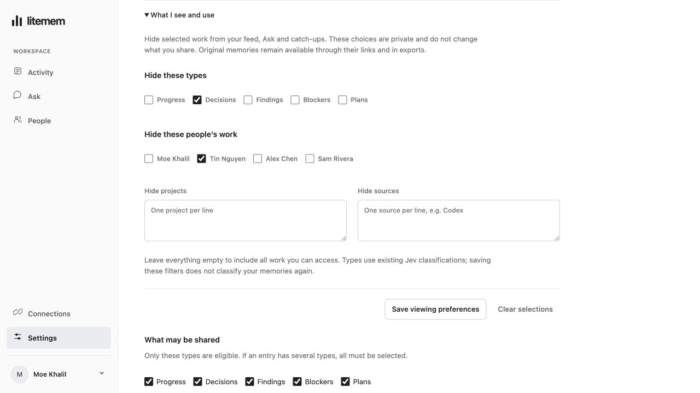
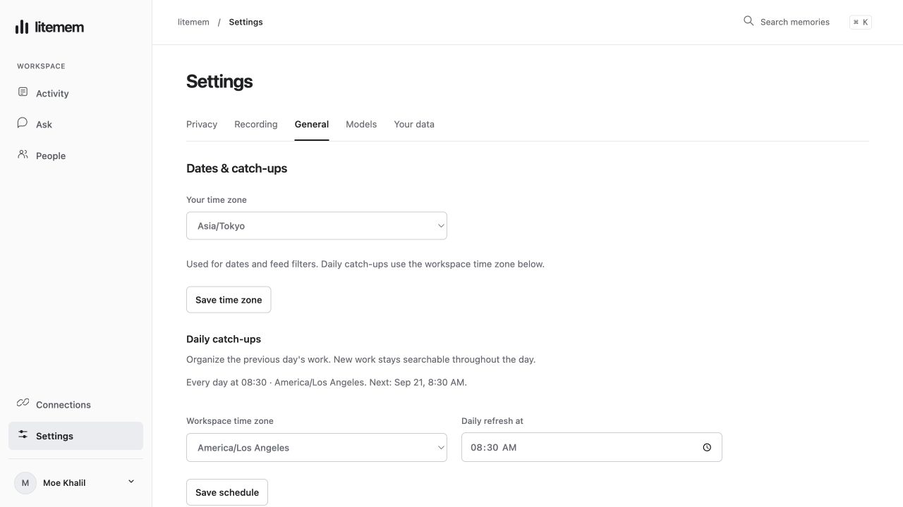

# Interface review — September 20, 2026

The interface was rebuilt as a compact internal workspace after the earlier design was rejected. This review covers twenty distinct areas, including repeated checks after fixes. It is not a claim of twenty complete end-to-end audits or zero remaining defects.

The screenshots below are the running application with synthetic local profiles, records and model responses. No real teammate history was imported or published. The production app contains no seeded activity. Real gateway, Slack, deployment and answer-quality gates remain in the [release checklist](release-checklist.md).

## Review matrix

| # | Area | Finding and resulting behavior | Evidence |
| --- | --- | --- | --- |
| 1 | Workspace structure | Replaced the earlier dashboard with a persistent sidebar, thin workspace bar, chronological activity and a contextual people column. Ask remains immediately accessible on Activity. | Desktop browser inspection; Activity screenshot below. |
| 2 | Navigation and browser history | View changes now update the URL fragment and document title. Back/Forward restore the view. Only view names enter the URL; private questions remain in tab memory. | Browser People → Ask → Back; reload preserved the selected view. |
| 3 | Private and company work | Private entries show both a lock and text. Company publications use a distinct audience label. Mobile retains the same labels. | Feed and original-source inspection, including a private citation. |
| 4 | Sharing review | The confirmation shows the exact proposed summary, audience and consequence before publication. A blocked preview explains why inside the source dialog. Cancel is initially focused. | Browser blocked-preview and allowed-preview scenarios; cancelled without publishing. Existing policy tests cover actual publication checks. |
| 5 | Source readability | Duplicate summary/content is suppressed. Raw source names have readable labels. Original evidence and metadata remain available in a disclosure; revisions link back to their originals. | Browser source and metadata views; source screenshot. |
| 6 | Manual capture and lost responses | Failed saves preserve the draft and report errors inside the dialog. Blank text is rejected. Retries keep both source ID and occurrence timestamp, avoiding a content-conflict error after a successful write whose response was lost. | Browser fixture persisted the entry then returned 503. Retry succeeded with one visible entry. |
| 7 | Corrections and duplicate requests | Corrections preserve the original, remain private and retain one request ID/timestamp on retry. Concurrent identical requests produce one record and one revision relation. Changed content cannot overwrite an existing request. | Lost-response browser scenario succeeded on retry. Two new lifecycle regression tests cover concurrent replay, exact dates, original isolation and API validation. |
| 8 | Stale source and overview responses | Detail opens immediately with a loading state. Responses for a closed/replaced source are ignored. Switching feed/person invalidates the old overview, including when the new feed has no overview. | Source inspection, cited-source navigation and request-generation review. |
| 9 | Search, filters and empty results | Source/type/date filters have an active count and clear action. Source is sent to the existing metadata filter. An empty filtered result explains how to recover. Invalid date ranges have an inline error. | Browser nonexistent-source filter → empty state → Clear filters; date and API parameter review. |
| 10 | People | Search displays the matching count. View work and Ask are separate actions. Missing profile images fall back to initials. The directory contains enrolled identities only. | Browser search for Tin, direct Ask with the correct person selected, and fallback rendering. |
| 11 | Ask scope | A person has an explicit scope option. Switching scope asks before discarding a conversation/draft. Activity Ask uses the person currently being viewed. Suggestions follow the selected scope. | Browser teammate Ask and scope selection; review of conversation reset and previous-job handling. |
| 12 | Running and cancelled answers | Scope, model, suggestions and new-conversation controls cannot start conflicting work. Stop requested before the job ID arrives is remembered. Streaming preserves manual scroll position. | Browser delayed-start → Stop → “Stopped.”; source review of job generation and cancellation. |
| 13 | Gateway model failures | A model failure leaves a persistent explanation and Reload models control. The selector says no models are available instead of remaining stuck on “Loading.” Ask becomes usable again after retry. | Injected `/api/models` 503, disabled Ask controls, then successful model reload. |
| 14 | Session expiration | A 401 clears private feed, messages, source details/actions, rules, overview and drafts, closes dialogs and shows Slack sign-in. Requests from the expired session cannot repopulate private content. Export downloads also check the session generation. | Browser injected 401 responses on search and export both returned the signed-out screen; review of JSON and download request paths. |
| 15 | Settings | Privacy, Recording, Models and Your data have separate sections. Loading settings cannot be edited before retrieval completes. Model roles and gateway maintenance are grouped without one long undifferentiated form. | Desktop and narrow-screen privacy/model settings inspection. Existing API tests cover revision conflicts, model changes and administration boundaries. |
| 16 | First-run setup and auth | Successful gateway connection collapses into its URL and a Change action. Models and Slack continue on the same page. Authentication screens use the same typography/forms. Jev failure names the missing gateway requirement. | Synthetic setup claim and gateway connection, model discovery and inline Slack section; four new gateway diagnostic cases. No live Jev success claimed. |
| 17 | Tool connections | MCP URL, Codex and Claude Code commands have copy actions and visible feedback. Continuous capture has its own explicit setup link. | Browser Copy Codex commands → Copied; empty connected-client state. Real CLI lifecycle tests remain part of CI. |
| 18 | Export | Readable JSONL and encrypted export are explicitly separate. Encrypted export explains its passphrase; closing clears it. Both download paths use one bounded UI flow and stop on session expiration. | Browser export dialog and close/focus return; existing encrypted export/restore tests and request-path review. |
| 19 | Transfer and departure | An invalid insecure destination fails inside the transfer dialog. Leaving explains revoked connections/access and focuses Cancel. Existing resumable transfer and account lifecycle behavior is preserved. | Browser invalid destination, cancellation and leave confirmation; lifecycle/transfer test suites. No actual departure or real history transfer in this review. |
| 20 | Responsive layout and accessibility | Navigation remains available at 320px. Ask/model controls, settings and private labels fit narrow layouts. Shared native dialogs provide focus trapping/Escape. Buttons restore focus after busy states; reduced-motion CSS is present. | Desktop 1280px inspection, 320px/390px responsive frame checks and narrow setup view; keyboard/focus checks. This is not a cross-browser or screen-reader certification. |

## Screenshots

Activity:

Ask, with a synthetic answer and a working source citation:

Privacy settings:

An original source:

Saved personal viewing preferences added in the product-contract follow-up:

## Validation and limits

- A subsequent product-contract audit added saved personal people/project/source/type exclusions, a project search filter and filtered catch-up variants. Browser checks verified saving a type/person selection, persistence after reload, and removal of the selected person's work from the company feed. Eleven additional regression cases cover private persistence, retrieval/agent enforcement, unchanged sharing/evidence, separate catch-ups, scope changes and authoritative Jev type labels. Shared-agent search no longer returns the requester's private archive counts. The full local suite now passes **119 tests**.
- Local automated suite: **108 passed**. Ruff and all four frontend module syntax checks passed. There is one pre-existing Starlette/AnyIO deprecation warning.
- [CI run 35546428674](https://github.com/moe-berri/litemem/actions/runs/35546428674) passed on source `f77e76d`, including the same suite, real Codex/Claude Code capture-hook checks, and the Docker/PostgreSQL/Ente restart and clean-volume restore.
- Browser checks exercised the real ASGI routes and encryption/archive implementation using temporary storage, fake Ente storage and a mock gateway. Delayed replies and 401/503 failures were injected only in the local test fixture.
- Responsive checks used a same-origin frame around the unchanged app at 320px/390px because the browser viewport override did not consistently target the requested tab. Same-origin framing was enabled only by the ignored, loopback-only test fixture. Production retains `frame-ancestors 'none'` and `X-Frame-Options: DENY`.
- The review checked accessible names, keyboard focus, cancellation and narrow layouts. It does not replace assistive-technology testing, a broad browser matrix, production load testing or the real-history answer-quality evaluation.
- Source text and private prompts are never inserted as executable HTML. Markdown continues through DOMPurify, and external links retain safe target/rel handling. UI permissions supplement server authorization; they do not grant access.

For a release, rerun the relevant scenarios against the deployed owner-only pilot after the gateway and Slack prerequisites are satisfied. Record the actual released revision and CI evidence in the release checklist.

The API contract follow-up switched the main web app and setup to `/api/v1`. Browser checks repeated personal type/person exclusions, save/reload, clearing exclusions and a complete synthetic Ask response. Compatibility aliases share the same handlers and rate limits. Local validation now passes **123 tests**. These checks do not replace the live integration gates.

The scheduling review adds **General** settings for personal date display and admin-owned daily timing. Browser checks saved Tokyo display dates and a Los Angeles daily schedule, reloaded both, verified the feed’s calendar dates, and retried an injected 503 without losing the edited time. The source original and privacy labels stay intact. The General tab and stacked fields were also visually checked in a 390px frame. Local validation now passes **134 tests**, including DST, different-day cache isolation, late evidence, private settings, date bounds and failed persistence.

