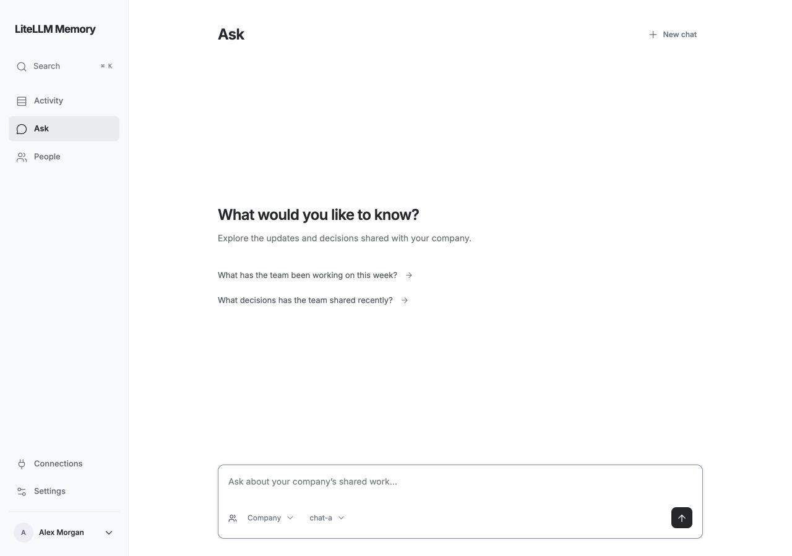
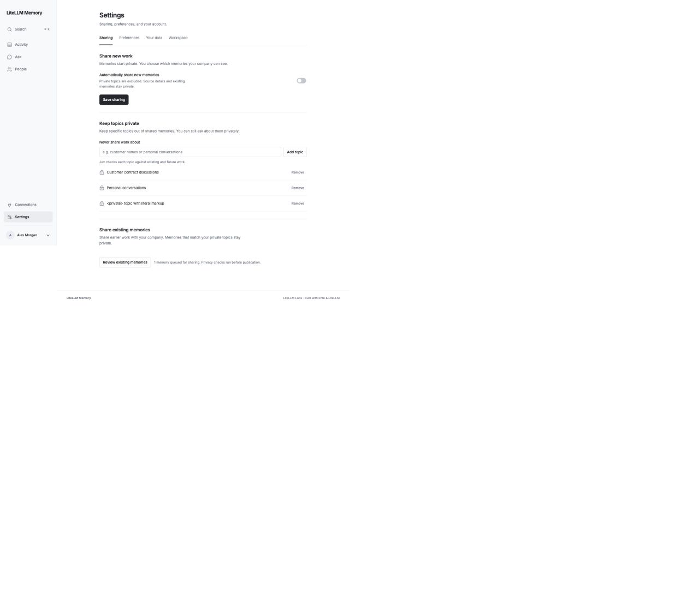
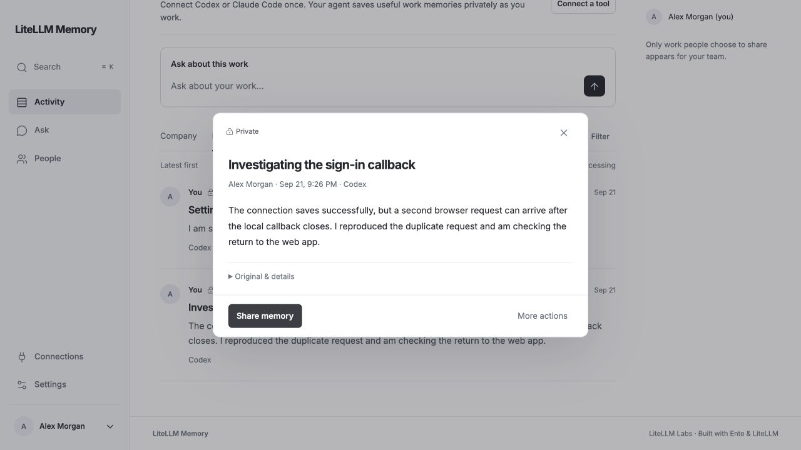

# Interface guide

The UI uses a shared hierarchy: 24px page titles, 16px content titles, 14px body, 13px controls, and 12px supporting detail. Settings uses one reading column: section purpose, controls, then the related action. Personal tabs precede the administrator-only Workspace tab. Placeholders remain secondary; narrow desktop panes do not trigger touch-sized input text.

The UI uses one sidebar, a chronological feed, explicit private/company labels, and a single-column Ask conversation. Search and advanced filters stay out of the way until needed. Icons use one Lucide grid and local font assets; there is no frontend build step or external font request.

The LiteLLM Memory wordmark uses 17px text so the full name stays readable at desktop and mobile widths.

The maintained [LiteLLM Memory UI skill](../.agents/skills/litellm-memory-ui/SKILL.md) explains the design language and how to extend it.

## Workspace setup

Setup uses one spacing pattern: section title and explanation, related fields, then action and feedback. Helpers stay close to their field; Slack permission guidance has a separate action group. Expanded model and Slack forms follow the same rhythm. Empty status messages do not reserve space.

## Search and the compact header

Search opens a panel near the top of the window, keeping scope and results together. It leaves the page underneath in place. Submit explicitly, open sources from results, and use Escape or Close to return. In the compact header the wordmark, Search and account control share a center line; the six destinations occupy two evenly spaced rows below on narrow screens.

[View the compact header](assets/header.jpg).

## Activity

Company is the first tab and opens by default; My work is second. Ask about the selected feed, or open an entry to inspect its source. Private entries carry both a lock and a label. Date and time align at the right. Read more expands the complete memory inline; Show less collapses it. The title independently opens detail.

## Daily summaries

The sidebar date browser has Company/My work scopes, Previous/Next navigation across days with generated summaries and a date picker. Person views reuse the same summaries with Activity/Daily summaries navigation. Activity and Summaries share page and reading-column widths. Each author has one readable text section, an audience label and source links. The empty state says “None available yet”; generation failures and pending jobs never appear as entries. Summaries cover completed days only and generate nightly at midnight by default; today stays in Activity.

The September 22 review uses synthetic records and simulated inference. At 1280px, both views measured a 1072px page and 728px reading column. At 687px, 390px and 320px, their column widths also matched exactly, with no horizontal overflow. Checks covered generated and empty states, tab navigation, date changes, private labels, source dialogs, Escape focus restoration and an empty browser error log. Earlier checks covered loading, network-read failure/retry and route reload/Back. The workspace footer has been removed. Existing screenshots below predate the additional navigation destination. This review does not certify million-token inference or live Slack delivery.

## People and recording

Select a person from the feed or directory to browse their shared work. The person’s name and query scope stay visible, and the route survives reload and Back.

Connections puts saved-work status and connected tools first. Setup and recording controls are separate disclosures. Old-conversation imports are outside the core experience. Pause/resume and processing retries live here; manual MCP setup and troubleshooting are in the connection guide. A connected credential and a saved-work receipt remain separate facts.

## Ask

Choose the memory scope and a gateway model. Responses include clickable source citations. Composers omit repeated privacy boilerplate; memory entries still show their audience. Stop cancels work; changing scope confirms before clearing a conversation.

## Sharing

Memories start private. Future sharing is opt-in. Write topics that Jev should keep private; no predefined category grid is required. Existing restrictive policies remain enforced. Filtered beside Private opens an owner-only list of matching Jev topics. Share existing memories reviews eligible records before confirmation and leaves filtered or unfinished records private.

## Sources and metadata

Memory detail uses a compact reading column with the private label, title, author/date, and text. Agent-written memories are shown as written. Source details stay in a disclosure. One sharing action sits opposite a compact More actions menu; unavailable sharing has a specific, quiet status message. The layout is checked at desktop and 390px widths.

## Review scope

These are screenshots of the actual local application with synthetic records and simulated model replies. They do not establish live gateway or Slack readiness.

The core-loop review covers joining → Company → tool instructions → authorized/waiting → first received work → My work, person browsing/reload/Back, Ask scope, sharing preview, saved-filter editing, and recording pause. Browser checks include 1280px, 390px and 320px layouts, keyboard Settings navigation, source-dialog dismissal and recording-status failure/retry. Long connection commands scroll inside their own block without widening the page. Connections checks cover initial setup, automatic client-list refresh, a saved first-record receipt, pause/resume and failed-save rollback, and direct recovery from the paused Activity notice. Settings checks include personal/admin tab visibility, keyboard navigation and saving a time zone. The search review also covers Company/My work/person scopes, empty results, a simulated failure and retry, source detail returning to results, Escape with focus restoration, and a 400px-high window with scrolling results. Search and navigation fit at 320px without horizontal overflow.

The backend suite covers selective hook guidance without transcript uploads, optional agent instructions, owner-only intake receipts, expired/refreshed connections, import-versus-live status, private/shared access, on-demand overviews and independent Luna defaults. The September 21 spacing review also covers connected setup, model-save feedback, expanded models, gateway editing, Slack access recovery, Settings disclosures, Connections instructions, feed, Ask and search at narrow widths. Ruff and frontend syntax/format checks pass. UI capture was simulated through a disposable fixture; these checks do not prove a real host connection, external model quality or live Slack OAuth. The release checklist tracks those separately.

Use the [release checklist](release-checklist.md) for deployment status and `CONTRIBUTING.md` for repeatable checks. Previous development screenshots and chronological review logs were removed; Git history retains them. This is not a claim of a flawless interface or a complete screen-reader/browser certification.

Connector approval stays on the hosted site. Verified locally with disposable accounts and host files: approval → both host configurations saved → Connections first-memory guide; a deliberate local failure → no saved credential and a clear terminal recovery message. The browser never navigates to a connector loopback callback. The failure page was also checked at 390 × 844 with no horizontal overflow. These checks use synthetic data; they do not certify a teammate's machine or Slack account.

The latest sharing review covers cached matching-topic explanations, bulk-sharing counts and confirmation, inline memory expansion, right-aligned date/time, and compact composer controls at 1280px and 390px. Keyboard Escape restores focus from the topic dialog, including when opened above memory detail. No browser console errors or horizontal overflow were observed in these synthetic checks.
